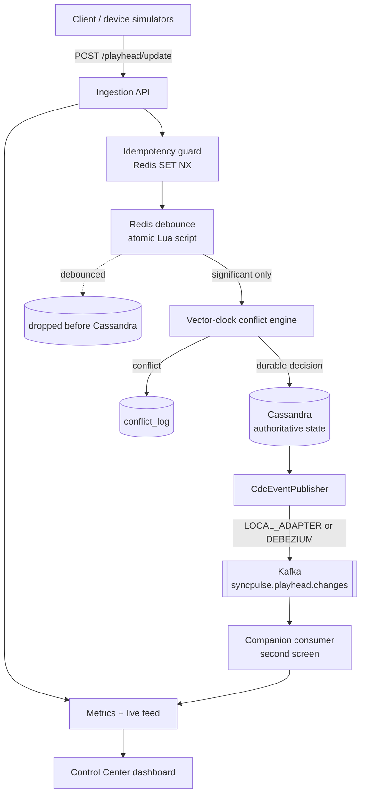
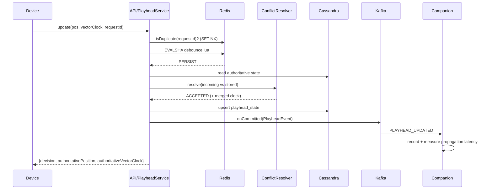
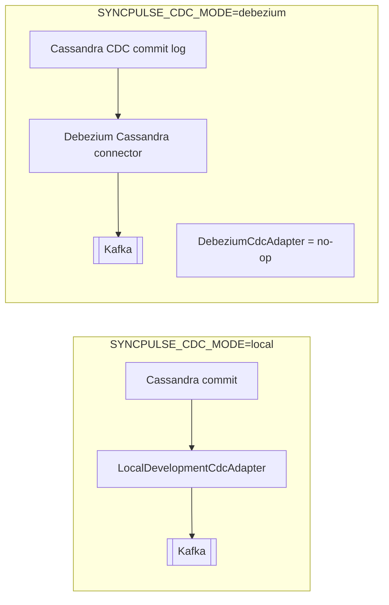

# SyncPulse — Architecture

## 1. Layered pipeline

Every playhead update flows through a fixed set of layers with clean interfaces, so any
infrastructure piece can be replaced without touching the others.



## 2. Component responsibilities

| Layer | Responsibility | Key class |
|---|---|---|
| Ingestion API | Validate, correlate (request id), route | `PlayheadController`, `PlayheadService` |
| Idempotency | Claim `requestId` atomically; dedupe retries | `IdempotencyService` |
| Debounce | Drop redundant high-frequency pings in Redis | `DebounceService` + `debounce.lua` |
| Conflict engine | Causal ordering; accept/reject/resolve | `ConflictResolver`, `VectorClock` |
| Durable store | Authoritative state, device registry, audit | `*Repository` (DataStax `CqlSession`) |
| CDC | Turn a commit into an event | `CdcEventPublisher` + adapters |
| Streaming | Transport events to consumers | `KafkaEventProducer`, Kafka |
| Consumer | React downstream without polling | `CompanionListener` |
| Observability | Metrics, feeds, status | `MetricsService`, `LiveEventLog`, `SystemStatusService` |

## 3. Request lifecycle (normal accept)



## 4. Data flow, in words

1. A device sends a playhead ping.
2. The `requestId` is claimed in Redis; a duplicate short-circuits as `IDEMPOTENT`.
3. The **atomic Lua debounce** decides `PERSIST` / `DEBOUNCED` / `FORCE_PERSIST`. Debounced
   pings never touch Cassandra — this is the write-reduction mechanism.
4. For significant pings, the **conflict engine** reads the stored clock and compares causally.
   Stale updates are rejected; concurrent updates are detected and deterministically resolved.
5. Durable decisions upsert `playhead_state` (single-partition write). Conflicts are appended to
   `conflict_log`.
6. The `CdcEventPublisher` turns the commit into a versioned event on Kafka.
7. The companion consumer receives it and measures commit→consume propagation latency.
8. The dashboard polls metrics/feeds/state/conflicts/consumer for a live view.

## 5. Failure handling

| Failure | Behaviour |
|---|---|
| Redis down | `503 REDIS_UNAVAILABLE`; debounce fails **open** (persist) on malformed script results rather than dropping data |
| Cassandra down | `503 CASSANDRA_UNAVAILABLE`; driver auto-reconnects; schema init retries |
| Kafka down | Publish uses bounded `delivery.timeout.ms`/`max.block.ms`; failures counted (`kafkaFailed`), never infinite-retried |
| Malformed / negative / over-duration position | `400 VALIDATION_ERROR` |
| Duplicate request | Idempotent no-op |
| Consumer failure | At-least-once redelivery via Kafka offsets |

No exception is silently swallowed; all map to structured JSON via `GlobalExceptionHandler`.

## 6. Kafka event schema

Versioned and extensible (`PlayheadEvent`):

```json
{
  "eventId": "uuid",
  "eventType": "PLAYHEAD_UPDATED",
  "version": 1,
  "occurredAt": "2026-09-02T16:08:40.123Z",
  "userId": "user-001",
  "contentId": "movie-inception",
  "deviceId": "tv-001",
  "positionSeconds": 420,
  "vectorClock": { "tv-001": 12, "phone-001": 4 },
  "decision": "ACCEPTED",
  "revision": 7,
  "cdcSource": "LOCAL_ADAPTER"
}
```

## 7. CDC adapters



The interface (`CdcEventPublisher`) is identical; only the commit-detection mechanism differs,
and events are honestly labelled by `cdcSource`.
