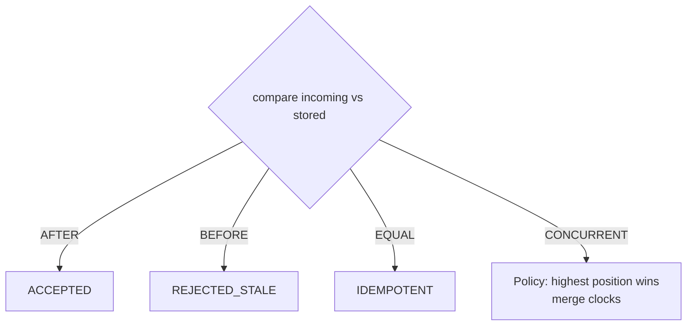

# SyncPulse — Vector Clocks & Conflict Resolution

## 1. Why not wall-clock time?

Devices don't share a trustworthy clock. Phone and TV clocks drift, are set by users, and jump
across timezones and NTP corrections. If we resolved "which update is newer" by comparing
timestamps, a phone with a fast clock could overwrite genuinely newer TV progress. **Causality,
not chronology, is what we actually need**, and vector clocks capture causality directly.

## 2. What a vector clock is

A vector clock is a map `deviceId → counter`:

```json
{ "phone-001": 5, "tv-001": 8, "web-001": 2 }
```

A missing device is implicitly `0`. Each device increments **its own** component when it produces
a new update. Implementation: [`VectorClock`](../backend/src/main/java/com/syncpulse/domain/VectorClock.java).

Operations:

- `increment(deviceId)` — bump this device's counter (a local event).
- `merge(a, b)` — element-wise **maximum** (the least upper bound; dominates both inputs).
- `compare(a, b)` — the causal (happened-before) partial order.

## 3. The comparison

For clocks A and B, comparing component-by-component (absent = 0):

| Condition | Result |
|---|---|
| every A ≤ B, at least one A < B | **BEFORE** (A happened-before B) |
| every A ≥ B, at least one A > B | **AFTER** |
| all equal | **EQUAL** |
| some A < B **and** some A > B | **CONCURRENT** (neither dominates) |



## 4. Worked examples (SyncPulse)

### BEFORE → REJECTED_STALE (the offline-device case)

```
Stored (after TV advanced):   { phone-001: 4, tv-001: 12 }   position 420
Incoming (phone, was offline): { phone-001: 4 }               position 120
```

Component-by-component: `phone-001` 4 = 4, `tv-001` 0 < 12. Every component ≤, one strictly < →
**BEFORE**. The phone never saw the TV's updates, so its clock is causally behind. The update is
**REJECTED_STALE**; authoritative state stays at 420s. *No regression.*

> Modelling note: a device that has been offline and is *re-flushing a buffered observation* sends
> that observation's original clock (it made no new local events while offline), which yields a
> clean BEFORE. A device that instead makes **new** progress while partitioned increments its own
> component and produces a CONCURRENT clock — see below. SyncPulse demonstrates both.

### AFTER → ACCEPTED

```
Stored:    { phone-001: 4, tv-001: 8 }    position 120
Incoming:  { phone-001: 4, tv-001: 12 }   position 200
```

Every component ≥, one strictly > → **AFTER** → **ACCEPTED**, position becomes 200.

### EQUAL → IDEMPOTENT

Identical clocks → the same causal point → no state transition. (Request-level idempotency via
`requestId` catches accidental resubmits even earlier.)

### CONCURRENT → deterministic resolution

Two devices diverge from a common ancestor `{ web-001: 1 }` without seeing each other:

```
Stored (TV wrote first):  { web-001: 1, tv-001: 1 }   position 300
Incoming (phone):         { web-001: 1, phone-001: 1 } position 350
```

`phone-001` 1 > 0 (incoming greater somewhere) **and** `tv-001` 0 < 1 (incoming smaller
somewhere) → **CONCURRENT**. Neither dominates; there is no natural total order.

**Resolution policy — highest position wins.** Video progress is semantically monotonic-forward,
so the further-along position is the safest "Continue Watching" choice. Here incoming 350 > stored
300 → `CONCURRENT_ACCEPTED`, position 350.

**Convergence.** Whatever the position outcome, the stored clock becomes the **merge**
`{ web-001: 1, tv-001: 1, phone-001: 1 }`, which is AFTER both inputs. The losing update can never
re-trigger the same conflict, and all replicas converge — this is the vector-clock analogue of the
guarantee CRDTs provide by construction.

## 5. Client protocol (simulators)

Each device simulator maintains its own clock:

1. On a local event (send), `clock = increment(clock, myDeviceId)`.
2. Send `{ position, vectorClock: clock }`.
3. On response **while online**, `clock = merge(clock, authoritativeVectorClock)` — the device
   learns everyone else's progress and stays causally current.
4. **While offline**, it does *not* merge — its clock freezes, which is exactly what makes a later
   reconnect detectable as stale (BEFORE) or concurrent.

## 6. Relationship to the literature

This design follows the vector-timestamp lineage (Lamport 1978 → Fidge 1988 → Dynamo, DeCandia et
al. 2007). CRDTs (Shapiro et al. 2011) are the documented alternative: they converge without
explicit comparison, but for a single monotonic scalar (a position) with a clear "latest-by-
causality wins" semantic, explicit vector-clock comparison maps more directly onto Cassandra's
model and is easier to *observe* — which matters for a teaching/demo system.
